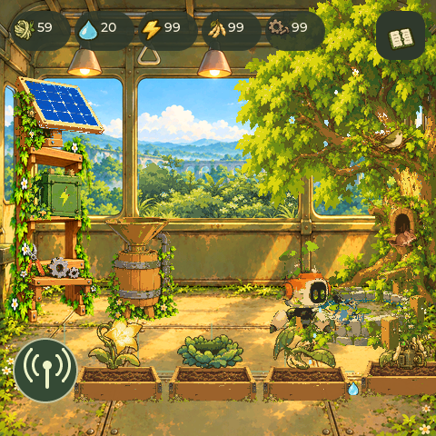
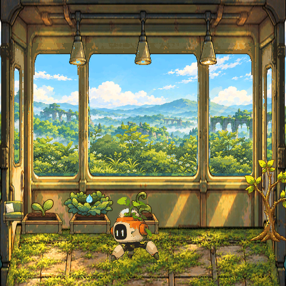
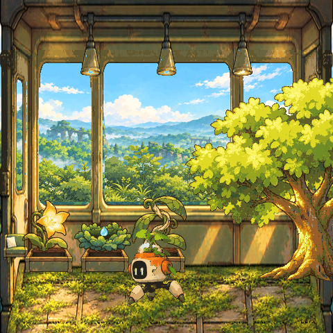
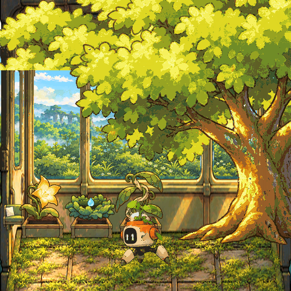
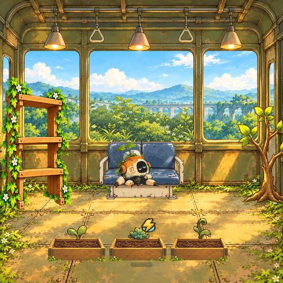
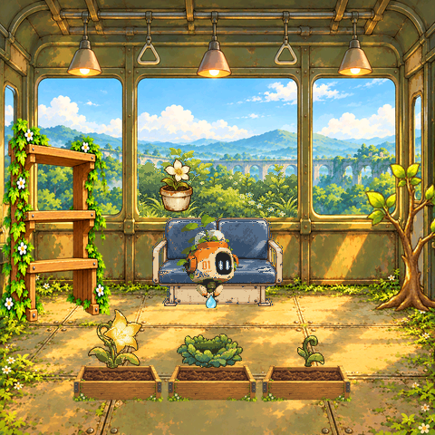
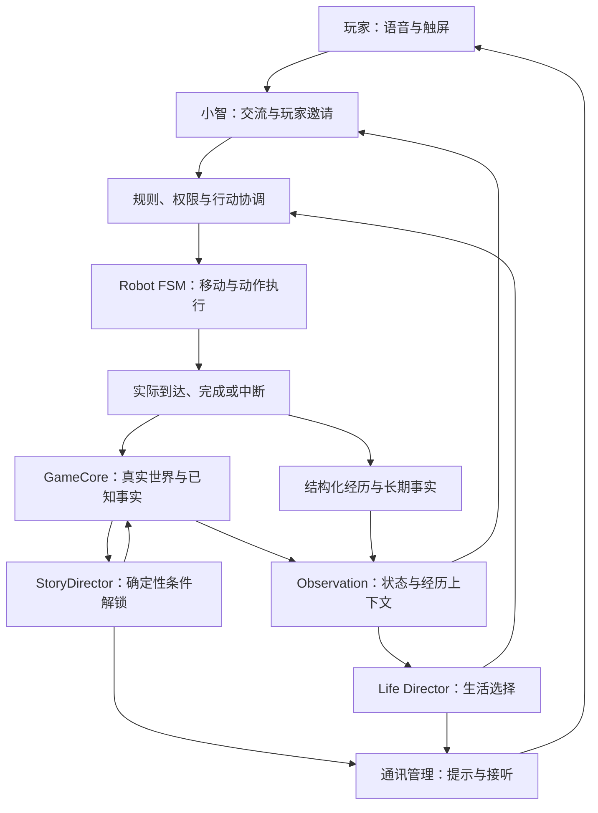

# 终点站是春天

**一节放在桌边的花园列车，一个逐渐拥有自己生活的园丁。**

《终点站是春天》是一款运行在 ESP32-S3 桌面设备上的 AI 角色养成与轻经营游戏。玩家和园丁机器人 **01-99** 一起种植、建造、照料车厢，也通过语音交流、日常观察和剧情选择，积累共同经历。

项目探索的是：**陪伴感，能否来自我们一起做过、看见过、记得的事情？**

<p align="center">
  
</p>

> 仓库中的场景图为项目本地原生游戏状态或界面预览，用于展示玩法与表现。它们不代表连续实机录像，或全部成长体验已经完成验收。

[游戏玩法](docs/GAMEPLAY.md) · [架构与代码入口](docs/ARCHITECTURE.md) · [运行与构建](docs/GETTING_STARTED.md) · [素材索引](docs/ASSETS.md) · [验证记录](docs/VALIDATION.md)

## 游戏体验

### 一起照看一个会变化的世界

车厢里的作物会生长，资源会消耗和恢复，设施需要施工，沿途地区影响经营条件。玩家安排种植与建设，园丁在同一个世界里照料、观察和执行任务。

| 幼苗与基础种植 | 作物成熟，大树成长 | 繁茂树冠与后续生态 |
| --- | --- | --- |
|  |  |  |

四类作物连接水、能源、藤纤维与食物的供给；旧零件和材料支持设施建设。储水、集能、工作台和种植位扩展，会改变后续经营条件。树冠繁茂后，可以进一步建设动物住所。

建造会经历**提出方案、明确批准、实际施工、竣工生效**。费用和结果由游戏规则处理，玩家可以看见自己的安排怎样改变车厢。

### 认识一个也在成长的园丁

01-99 起初围绕“维持生命”执行旧指令。随着有依据的协作与剧情推进，它开始认出玩家的帮助，也逐渐表达感受、形成生活习惯和提出自己的愿望。

| 工作之后，也可以休息 | 一朵没有产量的纪念花 |
| --- | --- |
|  |  |

一张旧座椅可以成为休息的地方。一盆没有生产收益的花，可以成为园丁想留下的东西。玩家可以同意、暂缓或拒绝，选择通过实际对象、行为与后续交流留下区别。

人格成长设计覆盖阶段 0–3：**重新启动、建立连接、学会生活、真正苏醒**。语言阶段、剧情进度和行动权限分别管理，表达生涩时也能正常维护植物。阶段 4“长期共同生活”是后续探索方向。

### 用语音和触屏，自然参与它的生活

玩家可以询问当前状态、邀请园丁检查植物、讨论已发现的档案，也可以先继续经营。重要发现通过通讯邀请承接；日常生活允许园丁先观察、休息，再在合适的时机分享。

这款游戏希望让一次交流有上下文：刚完成的照料、玩家批准的安排、一起讨论过的发现，都能成为下次交流的依据。

## 开发内核

项目把 **世界事实、角色理解、行动执行和经历记录** 连在一起。

### 世界有自己的规则与事实

`GameCore` 管理资源、作物、设施、动物、旅途、任务与剧情状态。费用、条件、结果和存档由本地规则提交。模型可以理解和提出候选，不能直接把库存改成想要的数值，或宣布一项未执行的建设已经完成。

### 决策有明确的输入与权限

角色读取真实快照、已解锁事实、近期经历和当前可用行动。设备侧调度负责维护与日常行为，可选的电脑侧小模型生成低频生活意图与短表达。执行前再次校验当前状态、来源与许可，过期或不合法的意图不会直接落地。

### 行动有实际的到达与完成

排队、前往、到达、完成和中断分别处理。状态机负责移动与动作，实际结果回写世界。对话、工作和自主生活需要协调：语音会话会暂停自主生活，玩家邀请的动作则通过已有入口与交流配合。

### 经历有来源，也有边界

设备保留有界的近期记录与长期事实，电脑终端可以归档接收到的事件。记录区分园丁独处、玩家批准与实际合作。发出请求不等于完成，屏幕亮着也不自动等于玩家参与。

当前记忆以结构化事件和事实为主。自由聊天自动沉淀、情感记忆与长期偏好推断，仍需要进一步实现和验证。

## 架构

### 借鉴 NVIDIA ACE 的角色分层思路

NVIDIA 的自主游戏角色资料以感知、认知、行动和表现解释角色能力。本项目借鉴职责分离的思路，再结合 MCU 游戏的资源与执行约束组织实现。[NVIDIA 官方架构介绍](https://www.nvidia.com/en-gb/geforce/news/nvidia-ace-autonomous-ai-companions-pubg-naraka-bladepoint/)

| 层次 | 在春天中的职责 |
| --- | --- |
| 感知 Perception | 世界快照、输入、可用行动与已解锁事实 |
| 认知与决策 Cognition | 小智交流、Life Director 生活选择，以及确定性的剧情条件判断 |
| 行动 Action | 规则与许可校验、任务协调、机器人 FSM |
| 表现 Rendering | LVGL 游戏画面、角色动作、语音、字幕和通讯提示 |

**本项目没有接入 NVIDIA ACE SDK。** StoryDirector、规则校验与 FSM 是项目自身的职责划分，不能据此视为 ACE 固定模块或官方背书。

### 交流、自主生活与剧情，共用一个世界



- **交流循环**：玩家查询或邀请，角色基于真实状态回应，合法动作执行后留下结果。
- **生活循环**：世界与事件触发低频观察和选择，园丁在工作、安全与冷却条件下生活，并在合适时机申请分享。
- **剧情循环**：满足明确条件后解锁事实、档案和可讨论内容，选择再影响世界与后续交流。

三条循环平行分工。StoryDirector 使用确定性规则，剧情解锁不必都经过实体动作。模型也不需要逐帧控制游戏。图按职责说明模块关系，具体可用链路与集成边界以验证记录为准。

### 端、电脑与语音服务各自负责什么

| 位置 | 责任 |
| --- | --- |
| ESP32-S3 设备 | GameCore、经营规则、存档、画面、输入、动作与真实回执 |
| 电脑本地，可选 | 低频模型决策、意图桥接、经历归档与路演展示 |
| 小智语音服务 | ASR、LLM、TTS 与设备工具交互，需要自己的服务和绑定配置 |

可选本地模型当前以 `qwen3.5-4b` 的本机接口为默认。**模型运行在电脑端，未将该模型部署到 ESP32。** 游戏画面采用预先加工的图像资源与 LVGL 绘制，不在设备上实时生成图片。

## 工程入口

```text
vendor/xiaozhi-esp32/main/game/     世界、经营、剧情、生活与记忆
vendor/xiaozhi-esp32/main/boards/
  waveshare/esp32-s3-touch-amoled-2.16/
                                  硬件接入、画面、动作、语音工具与路演切换
robot-mind/                       本地生活决策、上下文与 USB 桥接
monitor/                          状态页、事件归档与路演终端
assets/art-v1/                    原图、图集、动作、场景与加工结果
cloud-config/                     园丁角色及知识库参考模板
tests/                            核心、界面、协议与终端测试
prebuilt/                         与提交基线配套的固件及资源
```

详细入口见 [架构与代码说明](docs/ARCHITECTURE.md)。

## 快速体验与复现

- **看画面与玩法**：下载后打开 [美术预览](assets/art-v1/preview.html) 或 [经营回放](assets/art-v1/economy-preview.html)。它们是视觉预览与预生成回放，并非完整游戏模拟器。
- **运行电脑终端**：安装 Python 依赖后运行 `python monitor/server.py`，访问 `http://127.0.0.1:8766`。默认只观察设备状态。
- **使用路演终端**：运行 `python monitor/roadshow_server.py`，访问 `http://127.0.0.1:8767`。情境切换使用独立路演存档，并提供返回正式世界入口。
- **构建硬件工程**：目标板为 Waveshare ESP32-S3-Touch-AMOLED-2.16，ESP-IDF v6.1，16 MB Flash，480×480 游戏画面。

首次编译需要联网获取锁定的第三方依赖。ESP-IDF SDK、本地模型权重和个人设备绑定信息未包含在仓库内。[完整运行、构建与验证步骤](docs/GETTING_STARTED.md)

## 当前验证与边界

2026-10-24 提交基线保留了以下验证记录：ESP32-S3 固件构建、27 个 C++ 核心测试程序、23 项终端 Python 测试、59 项本地决策 Python 测试，以及原生 LVGL 触摸与剧情界面检查。[验证详情](docs/VALIDATION.md)

这些记录证明相应代码与测试路径通过，不替代完整实机语音、温升、长期稳定性和人格成长体验的验收。阶段 4、自由聊天情感沉淀与量产外观仍是后续方向。接取练习属于实验内容。

本仓库基于该提交快照整理展示文档，未因更新 README 而宣称新增硬件能力。

## 素材与第三方来源

游戏美术使用用户参考图与 image_gen 制作，保留母版、提示词、图集坐标与加工脚本。固件实际使用的资源由源文件引用决定，历史变体与当前使用素材在 [素材索引](docs/ASSETS.md) 中区分。

小智上游版权与 MIT 许可保留在 [上游 LICENSE](vendor/xiaozhi-esp32/LICENSE)，依赖版本由 `dependencies.lock` 锁定。项目自身改动与素材未因本次上传额外授予新的开源许可。参见 [第三方来源说明](THIRD_PARTY_NOTICES.md)。
