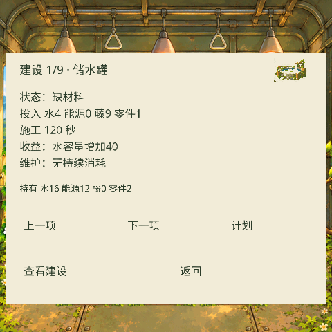
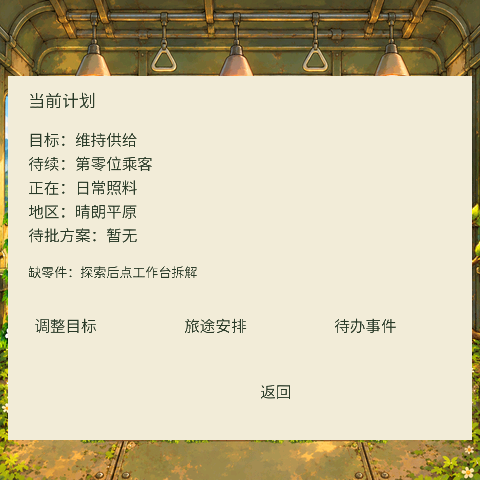

# 玩法与成长

- 在旧列车车厢种植轨光花、雨窝苔、缝甲藤与旅粮豆。水、能源、藤纤维、食物和旧零件构成经营循环。
- 作物产出支持设施建设。建设前查看费用与条件，明确批准后施工，竣工后才获得容量或生产效果。
- 树苗、成长树与繁茂树冠有可见变化。树冠为动物住所等后续经营提供条件，树不直接产资源。
- 经营随沿途地区变化。短缺、已批准安排、实际照料与收获会留下记录。
- 剧情通过短交流、可回看的档案和少量场景对象展开。休息、称呼、纪念花、动物议题与过去的线索关联玩家选择。
- 园丁可以维护、观察和休息。人格设计为阶段0至3：重新启动、建立连接、学会生活、真正苏醒。主讲中新增的阶段4属于后续共同生活方向，未作为当前固件已完成能力交付。
- 行为权限目前不因语言流畅就自动全部开放。批准、实际到达与完成均有自己的条件。

`docs/screenshots/` 是本地原生游戏状态/剧情预览，未用于宣称完整真机流程或长期体验验收已通过。

原生界面包含尚未通过长期验收的实验入口，例如接取练习。正常、演示和路演模式必须区分，不用路演预设覆盖正式进度。

## 本次从提交副本生成的界面

以上来自本地主机原生 LVGL 与设备字体渲染，使用合成测试状态，不是玩家存档截图。
